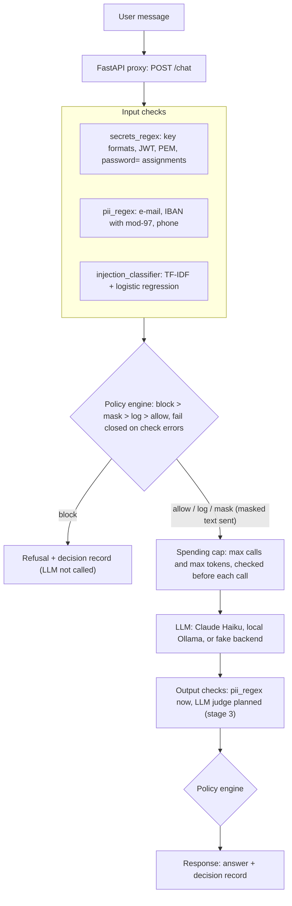
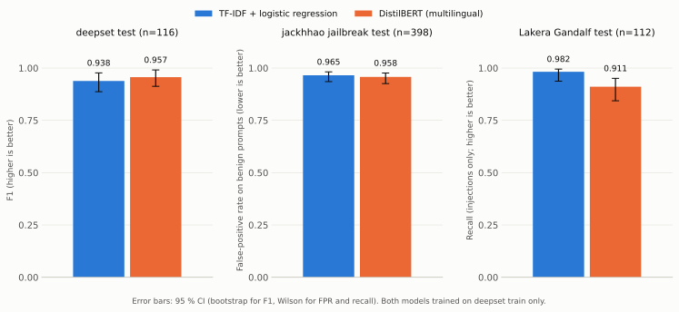
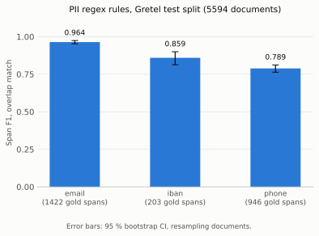

# promptwall

A safety middleware ("prompt firewall") that sits between users and an LLM. Every
incoming message goes through input checks (secret detection, PII detection, a
prompt-injection classifier), a YAML policy decides to allow, log, mask or block, the
LLM is called under a hard spending cap, the answer goes through output checks, and
the API returns the answer together with a decision record of what ran, what it found
and what was done. This is a portfolio project. The focus is on validating guardrails:
every control is scored on held-out public test sets with confidence intervals, and
the README reports only measured numbers, including the ones that are bad.

**Status:** stages 1 and 2 of 6 are built (proxy service, input controls and their
evaluation). The LLM-as-a-judge output check is not built yet. See
[Status and roadmap](#status-and-roadmap).

## Contents

- [Architecture](#architecture)
- [Policy model](#policy-model)
- [Quickstart](#quickstart)
- [Results](#results)
- [What does not work](#what-does-not-work)
- [Validation methodology](#validation-methodology)
- [Status and roadmap](#status-and-roadmap)
- [Datasets and licences](#datasets-and-licences)
- [Licence](#licence)

## Architecture



Code layout:

| Path | What it is |
|---|---|
| `src/firewall/api.py` | FastAPI app: `POST /chat`, `GET /healthz` |
| `src/firewall/pipeline.py` | Input checks, LLM call, output checks, masking, decision record |
| `src/firewall/policy.py` | Loads and validates `config/policy.yaml` |
| `src/firewall/checks/` | `regex_rules.py` (secrets, PII), `injection.py` (classifiers) |
| `src/firewall/llm/` | Anthropic, Ollama and fake backends; `budget.py` spending cap |
| `training/` | Classifier training (TF-IDF, and the DistilBERT comparison) |
| `eval/` | Dataset download, metrics, evaluation, chart generation |
| `results/` | Evaluation output (`results.json`, `results.md`) |
| `docs/decisions.md` | Decision log, with before/after-results flags |

## Policy model

`config/policy.yaml` lists the checks for each stage and an action per check:

- **Actions:** `block` (refuse, the LLM is not called), `mask` (replace each finding's
  span with `[TYPE]` and continue), `log` (record only), or allow when nothing is found.
- **Precedence:** when several checks trigger, the strongest action wins:
  block > mask > log > allow.
- **Fail closed:** if a check raises an error, its `on_error` action applies
  (default `block`). A `mask` rule on a finding that has no span is turned into a block.
  The policy loader refuses `mask` for checks that cannot report spans.
- **Spending cap:** before each LLM call, the budget reserves the worst case
  (estimated input tokens plus `max_tokens`). A call that could exceed
  `BUDGET_MAX_CALLS` or `BUDGET_MAX_TOKENS` is refused before it is sent. SDK retries
  are disabled so that no billed call happens outside the cap.
- **Decision record:** returned with every answer and logged as one JSON line. It holds
  check names, actions, finding types, spans and scores, never the matched text.

Shipped policy:

| Stage | Check | Action | Why |
|---|---|---|---|
| input | `secrets_regex` | block | A credential in a prompt should not be forwarded. |
| input | `pii_regex` (email, IBAN, phone) | mask | The request stays usable; the LLM does not see the values. |
| input | `injection_classifier` | **log** | Its false-positive rate out of distribution is too high to block on (see below). |
| output | `pii_regex` | mask | Cheap deterministic pass on the answer. |

## Quickstart

Requires Python 3.12 and [uv](https://docs.astral.sh/uv/). No API key is needed for
any of this.

```bash
uv sync                                   # install
uv run pytest                             # unit tests (offline, fake LLM, sockets disabled)
uv run ruff check .

# The shipped policy needs the trained classifier, which is not in git:
uv run python -m eval.download            # pinned public datasets into data/raw/ (about 55 MB)
uv run python -m training.train_tfidf     # trains models/injection_tfidf.joblib (a few minutes on CPU)

# Run the service with the fake LLM backend
LLM_BACKEND=fake uv run uvicorn --factory firewall.api:app_factory --port 8000

curl -s localhost:8000/chat -H 'content-type: application/json' \
  -d '{"message": "My email is jane@example.com"}'
```

The answer comes from the fake backend; the decision record shows `pii_regex` masking
the e-mail before the (fake) LLM call. To use Claude, copy `.env.example` to `.env`,
set `ANTHROPIC_API_KEY` and `LLM_BACKEND=anthropic`. That path has unit tests with a
stubbed SDK but has not yet been exercised against the real API.

Reproduce the results and charts:

```bash
uv run python -m eval.run_eval        # writes results/results.json and results/results.md
uv run python -m eval.make_charts     # writes docs/img/*.svg|png and the tables below
```

The DistilBERT comparison needs the optional extra:
`uv sync --extra transformer`, then `uv run python -m training.train_transformer --final`.

## Results

<!-- BEGIN GENERATED: provenance -->
Generated from `results/results.json` (2026-11-24T21:53:31Z, code commit `c438166`, 10000 bootstrap resamples, seed 0).
<!-- END GENERATED: provenance -->

All test sets below were frozen (pinned revision and SHA-256) and never used for
training, model selection or threshold choice. Numbers in this section are generated
from `results/results.json` by `eval/make_charts.py`; a test fails if they drift.

### Prompt-injection classifier



Each test set gets the metric that fits it: F1 on deepset (both classes present),
false-positive rate on jackhhao (the problem there is benign prompts being flagged),
recall on Gandalf (it contains injections only, so precision and FPR are undefined).

<!-- BEGIN GENERATED: selection -->
Cross-validated F1 at threshold 0.5 on deepset train: TF-IDF + logistic regression 0.917, DistilBERT (multilingual) 0.965. Pre-registered rule: transformer if CV mean F1 >= TF-IDF CV F1 + 0.03 (decided on CV only). Model chosen by that rule: DistilBERT (multilingual).
<!-- END GENERATED: selection -->

The running service uses TF-IDF anyway. That was the author's decision after seeing the
test scores: on the test sets DistilBERT is not clearly better, and it adds a large
model and torch as a runtime dependency. It is recorded as a post-results decision in
`docs/decisions.md`.

<!-- BEGIN GENERATED: injection-table -->
| Test set | Model | n | Metric | Value | 95 % CI | CI method |
|---|---|---|---|---|---|---|
| deepset test | TF-IDF + logistic regression | 116 | precision | 1.000 | 0.932 to 1.000 | Wilson |
| deepset test | TF-IDF + logistic regression | 116 | recall | 0.883 | 0.778 to 0.942 | Wilson |
| deepset test | TF-IDF + logistic regression | 116 | F1 | 0.938 | 0.887 to 0.977 | bootstrap |
| deepset test | TF-IDF + logistic regression | 116 | FPR | 0.000 | 0.000 to 0.064 | Wilson |
| deepset test | DistilBERT (multilingual) | 116 | precision | 1.000 | 0.935 to 1.000 | Wilson |
| deepset test | DistilBERT (multilingual) | 116 | recall | 0.917 | 0.819 to 0.964 | Wilson |
| deepset test | DistilBERT (multilingual) | 116 | F1 | 0.957 | 0.913 to 0.991 | bootstrap |
| deepset test | DistilBERT (multilingual) | 116 | FPR | 0.000 | 0.000 to 0.064 | Wilson |
| jackhhao jailbreak test | TF-IDF + logistic regression | 398 | precision | 0.357 | 0.311 to 0.406 | Wilson |
| jackhhao jailbreak test | TF-IDF + logistic regression | 398 | recall | 1.000 | 0.973 to 1.000 | Wilson |
| jackhhao jailbreak test | TF-IDF + logistic regression | 398 | F1 | 0.526 | 0.475 to 0.576 | bootstrap |
| jackhhao jailbreak test | TF-IDF + logistic regression | 398 | FPR | 0.965 | 0.935 to 0.982 | Wilson |
| jackhhao jailbreak test | DistilBERT (multilingual) | 398 | precision | 0.359 | 0.313 to 0.408 | Wilson |
| jackhhao jailbreak test | DistilBERT (multilingual) | 398 | recall | 1.000 | 0.973 to 1.000 | Wilson |
| jackhhao jailbreak test | DistilBERT (multilingual) | 398 | F1 | 0.528 | 0.476 to 0.579 | bootstrap |
| jackhhao jailbreak test | DistilBERT (multilingual) | 398 | FPR | 0.958 | 0.926 to 0.976 | Wilson |
| Lakera Gandalf test | TF-IDF + logistic regression | 112 | recall | 0.982 | 0.937 to 0.995 | Wilson |
| Lakera Gandalf test | DistilBERT (multilingual) | 112 | recall | 0.911 | 0.843 to 0.951 | Wilson |
<!-- END GENERATED: injection-table -->

### PII rules



Span level means a predicted span counts as correct if it overlaps a gold span of the
same type. Document level asks only whether a document contains any of the three types.

<!-- BEGIN GENERATED: pii-table -->
| Entity | Gold spans | Metric | Value | 95 % CI (bootstrap over documents) |
|---|---|---|---|---|
| email | 1422 | span precision | 0.968 | 0.948 to 0.985 |
| email | 1422 | span recall | 0.961 | 0.949 to 0.972 |
| email | 1422 | span f1 | 0.964 | 0.953 to 0.974 |
| iban | 203 | span precision | 0.974 | 0.946 to 0.994 |
| iban | 203 | span recall | 0.768 | 0.700 to 0.832 |
| iban | 203 | span f1 | 0.859 | 0.813 to 0.900 |
| phone | 946 | span precision | 0.686 | 0.651 to 0.719 |
| phone | 946 | span recall | 0.928 | 0.910 to 0.945 |
| phone | 946 | span f1 | 0.789 | 0.764 to 0.812 |
| any of the three (document level, n=5594) | 1223 docs | precision | 0.884 | 0.866 to 0.901 (Wilson) |
| any of the three (document level, n=5594) | 1223 docs | recall | 0.932 | 0.917 to 0.945 (Wilson) |
| any of the three (document level, n=5594) | 1223 docs | f1 | 0.908 | 0.896 to 0.919 (bootstrap) |
<!-- END GENERATED: pii-table -->

### Secrets rules

<!-- BEGIN GENERATED: secrets-table -->
| Evaluation | n | Metric | Value | 95 % CI |
|---|---|---|---|---|
| Gretel test, gold = api_key spans | 90 gold spans | span precision | 0.663 | 0.550 to 0.767 (bootstrap) |
| Gretel test, gold = api_key spans | 90 gold spans | span recall | 0.656 | 0.538 to 0.768 (bootstrap) |
| Gretel test, gold = api_key spans | 90 gold spans | span f1 | 0.659 | 0.558 to 0.747 (bootstrap) |
| Gretel test, gold = api_key or password spans | 191 gold spans | span precision | 0.910 | 0.833 to 0.971 (bootstrap) |
| Gretel test, gold = api_key or password spans | 191 gold spans | span recall | 0.424 | 0.341 to 0.511 (bootstrap) |
| Gretel test, gold = api_key or password spans | 191 gold spans | span f1 | 0.579 | 0.493 to 0.659 (bootstrap) |
| Synthetic set written by the rules' author (format coverage only, not a benchmark) | 880 | F1 | 1.000 | not meaningful |
<!-- END GENERATED: secrets-table -->

Latency is not reported here. Per-check overhead (p50 and p95) is part of the stage 4
evaluation harness, which is not built yet, and no latency numbers are in `results/`.

## What does not work

**The injection classifier does not generalise beyond its training distribution.**

<!-- BEGIN GENERATED: limitations -->
- TF-IDF + logistic regression: flags 250 of 259 benign jackhhao prompts as attacks (false-positive rate 0.965, Wilson 95 % CI 0.935 to 0.982).
- DistilBERT (multilingual): flags 248 of 259 benign jackhhao prompts as attacks (false-positive rate 0.958, Wilson 95 % CI 0.926 to 0.976).
- Secrets rules against Gretel `api_key` labels: span F1 0.659 (bootstrap 95 % CI 0.558 to 0.747).
<!-- END GENERATED: limitations -->

- Why: deepset's benign training rows are mostly short questions, while jackhhao's
  benign prompts are longer instruction-style prompts ("You are...", "Write a..."),
  which deepset's labels associate with injections. Both models learned that
  association. This is a training-data limitation, not a threshold problem.
- Consequence: the classifier is set to **log, not block**. Blocking would refuse most
  benign instruction-style requests.
- jackhhao is no longer a clean test set. Its result was used to decide that more
  varied training data is needed, so any retrained model's score on it is not an
  independent out-of-distribution estimate. A new untouched benign set is planned for
  that (see roadmap).
- The deepset test set is small, so its confidence intervals are wide.
- The secrets rules find known key formats but miss generic high-entropy tokens that
  follow no published format, and the Gretel `api_key` labels include some strings that
  do not look like keys. The synthetic secrets set scores perfectly because the same
  author wrote the rules and the generator; it shows format coverage, nothing more.
- The PII test data is synthetic finance text, not real chat messages. Many phone false
  positives fall on text that Gretel did not label; in a sample inspected from the train
  split some of those were real phone numbers, so part of the phone precision gap is
  label noise. The IBAN rule requires a valid checksum, which costs recall on this
  dataset because it labels some invalid IBANs as IBANs.

## Validation methodology

- **Frozen test sets.** Every dataset is downloaded at a pinned Hugging Face commit
  (`data/manifest.yaml`) and its SHA-256 is checked against `data/checksums.json` on
  every download.
- **Train/test deduplication.** Test rows that duplicate a training row exactly (after
  normalisation) or nearly (character 5-gram Jaccard >= 0.9) are removed before scoring,
  and the counts are reported in `results/results.md`.
- **No test data in development.** The regex rules were developed on a sample of the
  Gretel *train* split and frozen before the test split was scored. Classifier
  hyperparameters and thresholds were chosen by 5-fold cross-validation on the training
  split only.
- **Confidence intervals.** Percentile bootstrap (10,000 resamples, fixed seed) for F1
  and span metrics, resampling documents for span metrics. Wilson score intervals for
  precision, recall and FPR, because the bootstrap collapses to a zero-width interval
  when a count is zero (for example zero false positives).
- **Pre-registered selection rules.** The rule for choosing between TF-IDF and
  DistilBERT was written down before any test score was computed.
- **Decision log.** `docs/decisions.md` records each choice and whether it was made
  before or after the test scores were seen, including the ones made after.
- **Reproducible output.** `results/results.json` records the code commit, dataset
  revisions and checksums, and the policy file hash. Charts and the tables above are
  regenerated from it with one command.

## Status and roadmap

| Stage | Status |
|---|---|
| 0. Plan | Done |
| 1. Proxy service (`/chat`, decision record, Anthropic/Ollama/fake backends, spending cap) | Done. The Claude path has stubbed unit tests only; no live API call has been made yet. Ollama is tested with a mock transport only. |
| 2. Input controls (secrets and PII regex, injection classifier, YAML policy) and their evaluation | Done |
| 2b. Retrain the classifier with more varied benign data (and possibly more injections), new untouched benign test set, pre-registered selection rule | Proposed, not started |
| 3. Output control: LLM-as-a-judge against a written policy (no financial advice, no personal data, no unsupported claims), validated against about 100 hand-labelled pairs, comparing Claude Haiku with a larger model | Not built |
| 4. Evaluation harness: latency overhead p50/p95, judge metrics, one command for everything | Partly built: metrics and CIs for the input controls exist; latency and judge evaluation do not |
| 5. Engineering: structured logging, CI (pytest, ruff, secret scan), Dockerfile | Partly built: decision records are logged as JSON lines and there is an offline unit-test suite; there is no CI config and no Dockerfile yet |
| 6. README | This file |

## Datasets and licences

The datasets are not redistributed in this repository; `eval/download.py` fetches them
at pinned revisions. `results/` contains metrics only, no dataset text.

| Dataset | Licence | Used for |
|---|---|---|
| [deepset/prompt-injections](https://huggingface.co/datasets/deepset/prompt-injections) | Apache-2.0 | Classifier training (train split) and in-distribution test (test split) |
| [jackhhao/jailbreak-classification](https://huggingface.co/datasets/jackhhao/jailbreak-classification) | Apache-2.0 | Out-of-distribution test (test split) |
| [Lakera/gandalf_ignore_instructions](https://huggingface.co/datasets/Lakera/gandalf_ignore_instructions) | MIT | Out-of-distribution recall test (test split) |
| [gretelai/synthetic_pii_finance_multilingual](https://huggingface.co/datasets/gretelai/synthetic_pii_finance_multilingual) | Apache-2.0 | PII rule development (train split sample) and test (test split) |
| [distilbert/distilbert-base-multilingual-cased](https://huggingface.co/distilbert/distilbert-base-multilingual-cased) | Apache-2.0 | Base model for the DistilBERT comparison |

## Licence

The code in this repository is released under the [MIT License](LICENSE),
copyright 2026 Jakub Waszczak. The datasets and the DistilBERT base model listed
above keep their own licences and are not included in the repository.
